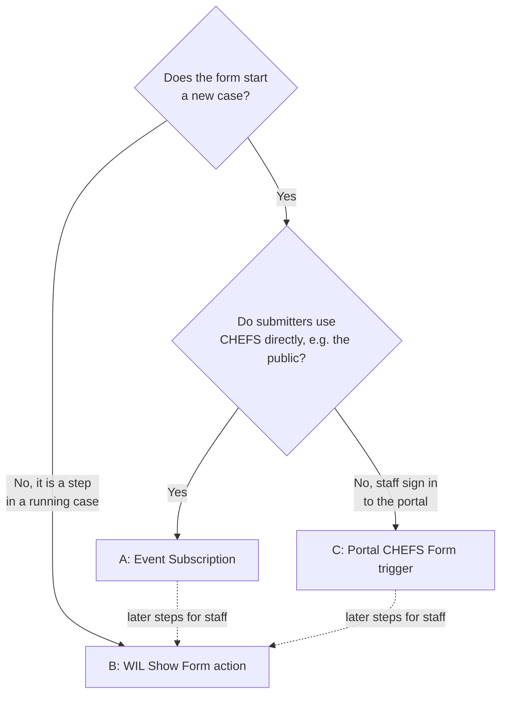

# Integrating CHEFS with n8n

This guide is for **workflow designers** and **client teams** who want to use [CHEFS](https://submit.digital.gov.bc.ca) (Common Hosted Form Service) forms in workflows hosted on the Common Hosted Workflow (CHW) platform (n8n plus the Workflow Interaction Layer, WIL).

CHW gives you three ways to connect a CHEFS form to a workflow. They solve different problems and can be combined in one workflow.

| #   | Pattern                                                     | Who fills in the form                                        | Where the form is shown                                 | What starts or resumes the workflow                                                                                              |
| --- | ----------------------------------------------------------- | ------------------------------------------------------------ | ------------------------------------------------------- | -------------------------------------------------------------------------------------------------------------------------------- |
| A   | [CHEFS Event Subscription](./event-subscription.md)         | Anyone with access to the CHEFS form (often the public)      | CHEFS itself (`submit.digital.gov.bc.ca`)               | CHEFS calls `…/rest/custom/v1/chefs/<path>` on submission, which fires an n8n **Webhook** (or resumes a **CHEFS Resubmit Wait**) |
| B   | [WIL Show Form action](./wil-show-form.md)                  | A specific user, group or role chosen by the workflow        | The **Workflow User Portal**, under the actor's actions | The workflow is already running; a **Workflow Interaction Layer** node creates the action and waits                              |
| C   | [Portal CHEFS Form trigger](./portal-chefs-form-trigger.md) | Signed-in portal users you allow (all, roles, groups, users) | The **Workflow User Portal**, under Triggers            | The user submits the form in the portal, which starts the workflow at a **WIL Trigger** node                                     |

## Which pattern should I use?

- **Pattern A** suits public intake forms. CHEFS stays the system of record for the submission, and CHEFS features such as **Recall**, status history and email notifications keep working. It is the only pattern that supports **resubmission** (the submitter edits the same submission and the waiting workflow resumes).
- **Pattern B** suits human steps inside a case: a reviewer completing an assessment form, a manager filling in a decision form. The workflow chooses who gets the form, can prefill it, and receives the result directly.
- **Pattern C** suits internal staff starting a case from the portal (for example "Start a new trip plan") without giving them the n8n editor or a webhook URL.

Typical combinations:

- **A → B**: a public applicant submits in CHEFS; a reviewer group then gets a Show Form action in the portal.
- **C → B**: a staff member starts a request from the portal; a second staff member approves it with a form.

## Building blocks

| Building block                                                                                      | Kind                 | Used by | Purpose                                                                                    |
| --------------------------------------------------------------------------------------------------- | -------------------- | ------- | ------------------------------------------------------------------------------------------ |
| `/rest/custom/v1/chefs/:webhookPath`                                                                | external-hooks route | A       | CHEFS-facing endpoint that forwards submission events to a webhook or a waiting execution  |
| **Webhook** (`n8n-nodes-base.webhook`)                                                              | n8n core node        | A       | Starts a new execution for a fresh submission                                              |
| [**CHEFS Resubmit Wait**](./credentials-and-nodes.md#chefs-resubmit-wait)                           | CHW community node   | A       | Pauses an execution until the same submission is resubmitted                               |
| [**CHEFS Submission Extractor**](./credentials-and-nodes.md#chefs-submission-extractor)             | CHW community node   | A, B, C | Fetches a submission from CHEFS and picks out the fields you need                          |
| [**Common Hosted Form Service (CHEFS)**](./credentials-and-nodes.md#chefs-node)                     | CHW community node   | Any     | Read-only CHEFS API calls (submission, status codes, status history)                       |
| [**Workflow Interaction Layer**](./wil-show-form.md)                                                | CHW community node   | B       | Creates the Show Form action for an actor and waits for the result                         |
| [**WIL Trigger**](./portal-chefs-form-trigger.md#step-2--add-a-wil-trigger-node)                    | CHW community node   | C       | Entry point that the portal's CHEFS Form trigger starts                                    |
| [**CHEFS Form Authentication**](./credentials-and-nodes.md#chefs-form-authentication-chefsformauth) | n8n credential       | A, B, C | Form ID + API key for one CHEFS form. Used by the extractor, Show Form and portal triggers |
| **Header Auth**                                                                                     | n8n credential       | A       | Validates the shared key CHEFS sends with every event                                      |

## Before you start

You need:

1. A **published** CHEFS form, with you as an owner or form designer.
2. A CHEFS **API key** for that form (CHEFS → Manage Form → API Key). Each CHEFS form has its own key.
3. Access to an n8n **project** that is linked to your WIL tenant, so the portal can see your workflows and credentials.
4. For patterns B and C: the people who will use the form must be able to sign in to the Workflow User Portal for your tenant.

Then read the page for your pattern, and keep [Credentials, nodes and troubleshooting](./credentials-and-nodes.md) open as a reference.

## Further reading

- [WIL Trigger node](../../community-nodes/wil-trigger/README.md)
- [Workflow Interaction Layer node operations](../../community-nodes/workflow-interaction-layer/node-operations.md)
- [CHEFS embedding in the portal (developer internals)](../../external-ui/WIL/chefs-integration.md)
- [Trigger targets (developer internals)](../../external-ui/WIL/trigger-targets.md)
- [CHEFS Submission Extractor README](https://github.com/bcgov/common-hosted-workflow/blob/main/community-nodes/nodes/CHEFSSubmissionExtractor/README.md)
- CHEFS docs: [Event Subscription](https://developer.gov.bc.ca/docs/default/component/chefs-techdocs/Capabilities/Integrations/Event-Subscription/), [Recall Submission](https://developer.gov.bc.ca/docs/default/component/chefs-techdocs/Capabilities/Functionalities/Recall-Submission/), [Generating API keys](https://developer.gov.bc.ca/docs/default/component/chefs-techdocs/Capabilities/Data-Management/Generating-API-keys/)
