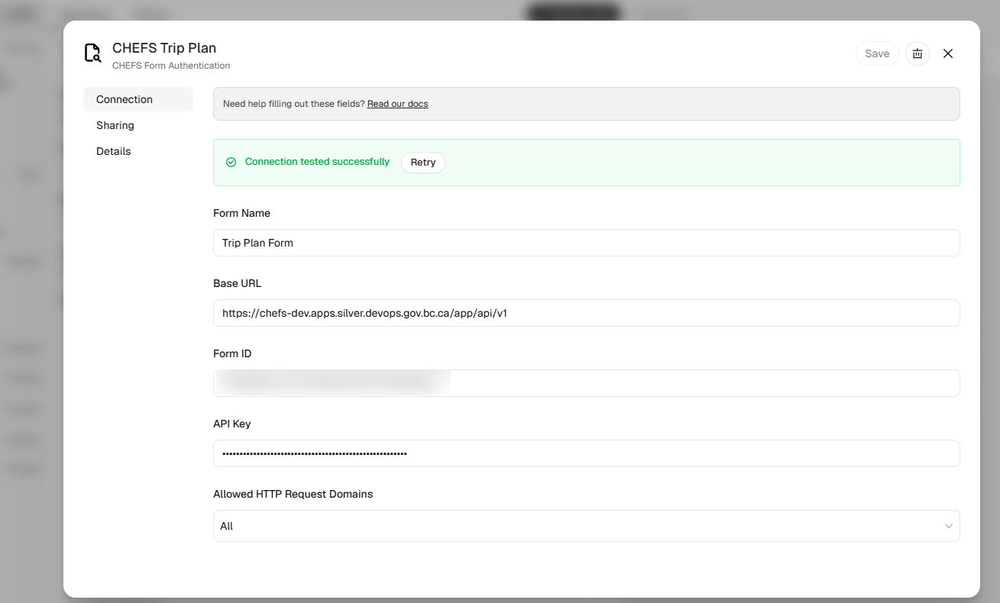
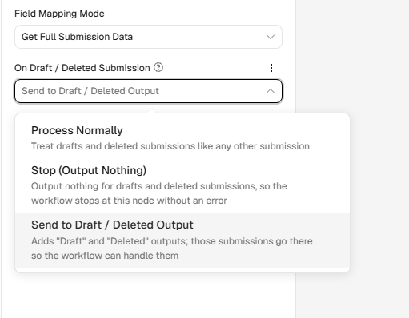
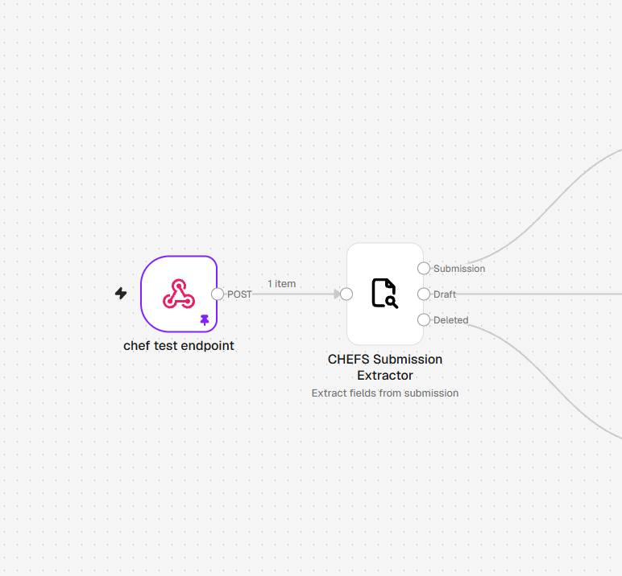

# CHEFS credentials, nodes and troubleshooting

Reference for everything CHEFS-related on the platform. Start with the [overview](./README.md) to pick a pattern.

## Credentials

| Credential                                                            | Type name                     | Holds                                 | Used by                                                                               |
| --------------------------------------------------------------------- | ----------------------------- | ------------------------------------- | ------------------------------------------------------------------------------------- |
| [CHEFS Form Authentication](#chefs-form-authentication-chefsformauth) | `chefsFormAuth`               | Form name, base URL, form ID, API key | CHEFS Submission Extractor, WIL **Show Form** actions, portal **CHEFS Form** triggers |
| [CHEFS API](#chefs-api-chefsapi)                                      | `chefsApi`                    | Local authorization token, API key    | **Common Hosted Form Service (CHEFS)** node only                                      |
| Header Auth                                                           | `httpHeaderAuth` (n8n)        | Header name + secret                  | **Webhook** and **CHEFS Resubmit Wait** in [pattern A](./event-subscription.md)       |
| Workflow Interaction Layer API                                        | `workflowInteractionLayerApi` | WIL API access                        | **Workflow Interaction Layer** node                                                   |

### CHEFS Form Authentication (`chefsFormAuth`)

One credential per CHEFS form (and per CHEFS environment).

| Field     | Notes                                                                                                                     |
| --------- | ------------------------------------------------------------------------------------------------------------------------- |
| Form Name | Friendly name shown in pickers. Not sent to CHEFS.                                                                        |
| Base URL  | CHEFS API base URL. Default `https://submit.digital.gov.bc.ca/app/api/v1`. Use the dev/test CHEFS URL for non-prod forms. |
| Form ID   | The CHEFS form ID. Sent as the Basic auth user name.                                                                      |
| API Key   | The form's API key from CHEFS → Manage Form → API Key. Sent as the Basic auth password. Stored encrypted.                 |

**Test** in n8n requests a token from the CHEFS gateway for the form, so a successful test proves the form ID / API key pair works for that base URL.

Where it can be created:

- in n8n (**Credentials → Create → CHEFS Form Authentication**), or
- in the Workflow User Portal from the CHEFS Form trigger screen ([pattern C](./portal-chefs-form-trigger.md#step-1--create-a-chefs-form-authentication-credential)).

Rules that matter:

- For WIL actions and portal triggers, the credential must be owned by or shared with an n8n project linked to the tenant. The portal only lists credentials the signed-in user can read in n8n.
- The **Base URL** origin must be allowed by the platform (`CHEFS_BASE_URL` or `CHEFS_ALLOWED_ORIGINS`); credentials pointing elsewhere are rejected by the portal.
- The API key is never sent to the browser or stored in action payloads. Only the credential ID is.
- If you rotate the API key in CHEFS, update the credential. Existing actions and triggers keep working because they reference the credential, not the key.

### CHEFS API (`chefsApi`)

Used only by the **Common Hosted Form Service (CHEFS)** node. It has a local **Authorization Token** (a shared secret the node compares with its own token field) and the form's **API Key**. The node always calls production CHEFS. See [CHEFS API credentials](../../community-nodes/chefs/credentials.md).

## Nodes

### CHEFS Submission Extractor

Fetches one submission (`GET /submissions/{id}`) and returns only the fields you map.

| Setting                       | Notes                                                                                                                                                                                            |
| ----------------------------- | ------------------------------------------------------------------------------------------------------------------------------------------------------------------------------------------------ |
| Credential                    | CHEFS Form Authentication                                                                                                                                                                        |
| Submission ID                 | `{{ $json.body.submissionId }}` (pattern A), `{{ $json.submission_id }}` (pattern B), `{{ $json.input.submission_id }}` (pattern C)                                                              |
| Field Mapping Mode            | **UI Field Pairs**, **JSON** (`{ "city": "address.city" }`) or **Get Full Submission Data**                                                                                                      |
| Missing Path Behavior         | **Return Null** or **Throw Error**                                                                                                                                                               |
| On Draft / Deleted Submission | **Process Normally** (default) treats draft and deleted submissions like any other. **Stop** outputs nothing for them. **Send to Draft / Deleted Output** adds **Draft** and **Deleted** outputs |
| Include Submission Metadata   | Adds `_createdBy`, `_createdAt`, `_updatedBy`, `_updatedAt`                                                                                                                                      |

Paths are dot notation into the form data; numbers index arrays (`items.0.name`). In **Get Full Submission Data** mode the answers are under `submission.data` and flags such as `draft` and `confirmationId` are at the top level. Full reference: [CHEFS Submission Extractor README](https://github.com/bcgov/common-hosted-workflow/blob/main/community-nodes/nodes/CHEFSSubmissionExtractor/README.md).

#### On Draft / Deleted Submission

The node checks the submission's `draft` and `deleted` flags before any field mapping, so this works in every Field Mapping Mode. Pick one of three choices:

| Choice                             | Node outputs                           | A draft or deleted submission…                                                                    |
| ---------------------------------- | -------------------------------------- | ------------------------------------------------------------------------------------------------- |
| **Process Normally** (default)     | one                                    | passes through like any other submission. Nodes saved before this option existed behave this way. |
| **Stop (Output Nothing)**          | one                                    | produces nothing, so the run stops at the extractor without an error and shows as **Succeeded**   |
| **Send to Draft / Deleted Output** | **Submission**, **Draft**, **Deleted** | goes to its own output, with the same fields as a normal submission                               |

With **Send to Draft / Deleted Output**, the node shows three outputs on the canvas:

- A submission that is both a draft and deleted goes to **Deleted**.
- With several input items, each item goes to its own output. An output with nothing connected simply ends the run for its items.
- With **On Error → Continue (using error output)**, n8n adds an **Error** output after these. Items that fail with **Continue On Fail** go to **Submission**.

When does the extractor see one? Straight after the event it never sees a draft, because CHEFS only notifies on **Submit**. A later fetch can see a draft if the submitter has recalled the submission, or `deleted: true` if someone deleted it in CHEFS. See [Fetch the submission once](./event-subscription.md#step-2--build-the-workflow).

### CHEFS Resubmit Wait

A **Wait** node locked to **On Webhook Call** with two extra required fields, **Form ID** and **Submission ID**. Before pausing it registers `(formId, submissionId) → resume URL` with the platform, so the next `eventSubmission` for that submission resumes this execution. Use it with the same **Header Auth** credential as the Webhook. See [Resubmissions](./event-subscription.md#resubmissions-with-chefs-resubmit-wait).

### Common Hosted Form Service (CHEFS) {#chefs-node}

Read-only CHEFS API calls: **Submission → Get**, **Status → Get Form Statuses**, **Status → Get Submission Statuses**. Useful to check a submission's CHEFS status (for example `REVISING`) in a workflow. See [CHEFS node operations](../../community-nodes/chefs/node-operations.md).

### Workflow Interaction Layer

Creates WIL actions. **Show Form** shows a CHEFS form to an actor in the portal. See [pattern B](./wil-show-form.md) and [node operations](../../community-nodes/workflow-interaction-layer/node-operations.md).

### WIL Trigger

Entry node started by portal **Button** and **CHEFS Form** triggers. See [pattern C](./portal-chefs-form-trigger.md) and the [WIL Trigger node](../../community-nodes/wil-trigger/README.md).

## Data received by the workflow

| Source                                       | Where         | Shape                                                                   |
| -------------------------------------------- | ------------- | ----------------------------------------------------------------------- |
| Event Subscription → Webhook / Resubmit Wait | `$json.body`  | `{ formId, formVersion, subscriptionEvent, submissionId }`              |
| Show Form, default                           | `$json`       | `{ formId, submission_id }`                                             |
| Show Form, Skip CHEFS Submission             | `$json`       | `{ formId, formData: { … } }` (all fields, or only the selected fields) |
| CHEFS Form trigger, default                  | `$json.input` | `{ formId, submission_id }`                                             |
| CHEFS Form trigger, Skip CHEFS Submission    | `$json.input` | The form's field values as a flat object                                |

## Platform configuration

Set by the platform team; listed so designers know what to ask for.

| Variable                        | Service             | Purpose                                                                                                       |
| ------------------------------- | ------------------- | ------------------------------------------------------------------------------------------------------------- |
| `N8N_BASE_URL`                  | external-hooks, n8n | Public base URL. Used to build `/webhook/<path>` for event forwarding and by CHEFS Resubmit Wait to register. |
| `INTERNAL_AUTH_TOKEN`           | external-hooks, n8n | Shared secret CHEFS Resubmit Wait uses to call the internal register route.                                   |
| `CHEFS_BASE_URL`                | external-hooks      | Default CHEFS host (for example `https://submit.digital.gov.bc.ca`). Its origin is always allowed.            |
| `CHEFS_ALLOWED_ORIGINS`         | external-hooks      | Comma-separated extra CHEFS origins credentials may use (for example CHEFS dev/test).                         |
| `VITE_CHEFS_SCRIPT_PATH`        | external-ui         | Path of the CHEFS form viewer script, to pin a viewer version.                                                |
| `WIL_N8N_NODE_TRIGGERS_ENABLED` | external-hooks      | `false` turns off portal triggers.                                                                            |

## Troubleshooting

| Symptom                                                                                                                                                   | Likely cause and fix                                                                                                                                                                                                                                                                                                                                                                |
| --------------------------------------------------------------------------------------------------------------------------------------------------------- | ----------------------------------------------------------------------------------------------------------------------------------------------------------------------------------------------------------------------------------------------------------------------------------------------------------------------------------------------------------------------------------- |
| CHEFS submits but no execution appears                                                                                                                    | Workflow not active/published; Webhook **Path** differs from the last segment of the Endpoint URL; Endpoint URL points to the wrong environment.                                                                                                                                                                                                                                    |
| Execution list shows nothing, CHEFS reports `403` / authorization error                                                                                   | The CHEFS **Key** / **Endpoint Token** do not match the Header Auth credential's Name / Value on the Webhook (or on CHEFS Resubmit Wait for resubmissions).                                                                                                                                                                                                                         |
| CHEFS reports `400` for form publish / unpublish                                                                                                          | Expected: those events have no `submissionId` and are not forwarded.                                                                                                                                                                                                                                                                                                                |
| A resubmission starts a **new** execution instead of resuming                                                                                             | CHEFS Endpoint URL points at `/webhook/<path>` instead of `/rest/custom/v1/chefs/<path>`; or the run was not yet at **CHEFS Resubmit Wait**.                                                                                                                                                                                                                                        |
| CHEFS Resubmit Wait fails with `N8N_BASE_URL is not configured` / `INTERNAL_AUTH_TOKEN is not configured` / `Failed to register CHEFS submission webhook` | Platform configuration of the n8n runtime; contact the platform team.                                                                                                                                                                                                                                                                                                               |
| A resubmission after a **Limit Wait Time** timeout errors                                                                                                 | The stale registration still points at the finished execution. Start a fresh submission, or avoid time limits on CHEFS Resubmit Wait.                                                                                                                                                                                                                                               |
| Submitter has no **Recall Submission** button                                                                                                             | Recall disabled on the form, the user is not the submitter, or the submission is Assigned / Completed / Deleted in CHEFS.                                                                                                                                                                                                                                                           |
| Show Form action: node error `Select a "CHEFS Form Authentication" credential`                                                                            | Select the credential in the node's **Credentials** section.                                                                                                                                                                                                                                                                                                                        |
| Show Form action opens with "Cannot connect to CHEFS with the selected CHEFS credential"                                                                  | Wrong base URL, form ID or API key in the credential. Use **Test** on the credential in n8n.                                                                                                                                                                                                                                                                                        |
| Show Form action / trigger: `Not authorized to use this CHEFS credential`                                                                                 | The credential is not shared with a project linked to the tenant. Share it with the workflow's project.                                                                                                                                                                                                                                                                             |
| Form shows "Failed to load form"                                                                                                                          | The CHEFS viewer script could not load (network, or a blocked CHEFS origin). Refresh; if it persists, contact the platform team.                                                                                                                                                                                                                                                    |
| Trigger shows **Unpublished** / **Node removed**                                                                                                          | Publish the workflow again / restore the WIL Trigger node or re-point the trigger.                                                                                                                                                                                                                                                                                                  |
| Workflow missing from the trigger's workflow dropdown                                                                                                     | Not published; WIL Trigger's **Accepted Sources** lacks **CHEFS Form**; or the workflow's project is not linked to the tenant.                                                                                                                                                                                                                                                      |
| Extractor returns `null` for a field                                                                                                                      | The source path does not match the CHEFS field **API name** (check nesting such as containers, grids, `items.0.x`). Use **Get Full Submission Data** once to see the real structure.                                                                                                                                                                                                |
| Run stops at the extractor with no output, but shows **Succeeded**                                                                                        | The submission is a draft at the moment of the fetch, usually because the submitter recalled it. With **On Draft / Deleted Submission** set to **Stop**, it was dropped; with **Send to Draft / Deleted Output**, it went to the unconnected Draft output. Connect that output to handle it, and fetch right after the event and reuse that output instead of fetching again later. |

## Current limitations

- **No in-place editing from the portal.** Show Form with a Submission ID loads existing data, but submitting creates a new submission. Corrections to a submitter's own submission go through CHEFS **Recall** + **CHEFS Resubmit Wait**.
- **Resubmission needs Event Subscription.** CHEFS Resubmit Wait only resumes from events that arrive through `/rest/custom/v1/chefs/<path>`.
- **One waiting execution per submission.** Registering again replaces the earlier registration.
- **Timeouts leave the registration behind** on CHEFS Resubmit Wait (see Troubleshooting).
- **No access to the previously submitted version.** After **Recall Submission**, the CHEFS API returns the submitter's in-progress draft, and no API call returns the version they submitted. Fetch the submission right after the event and reuse that copy ([details](./event-subscription.md#step-2--build-the-workflow)).
- **No field selection for portal triggers.** Only Show Form actions support Selected Fields Only.
- **CHEFS node uses production CHEFS only.** For dev/test CHEFS forms use the CHEFS Submission Extractor (its credential has a Base URL).
