# Pattern A — CHEFS Event Subscription

CHEFS calls a URL on the workflow platform every time the form is submitted. The platform turns that call into either:

- a **new workflow execution** (a fresh submission), through an n8n **Webhook** node, or
- the **continuation of a waiting execution** (a resubmission of the same submission), through a **CHEFS Resubmit Wait** node.

Use this pattern when submitters fill in the form on CHEFS itself — typically public or external users.

## How it works

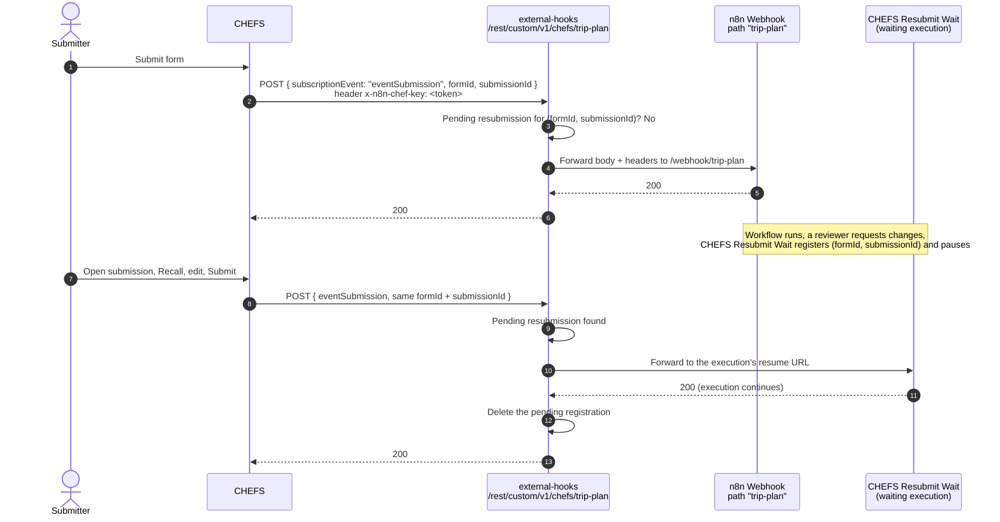

What the platform endpoint does with each call:

| CHEFS call                                                                             | What happens                                                                                                                               |
| -------------------------------------------------------------------------------------- | ------------------------------------------------------------------------------------------------------------------------------------------ |
| Body has no `formId` or `submissionId` (CHEFS form **publish** / **unpublish** events) | Rejected with `400` by request validation. No workflow runs. This is expected and harmless.                                                |
| Any other `subscriptionEvent` than `eventSubmission`                                   | Acknowledged with `200` and **ignored**. No workflow runs.                                                                                 |
| `eventSubmission`, and a **CHEFS Resubmit Wait** registered this form + submission     | Forwarded to that execution's resume URL. The registration is deleted once n8n accepts it.                                                 |
| `eventSubmission`, nothing registered                                                  | Forwarded to `https://workflow.digital.gov.bc.ca/webhook/<webhookPath>`, which starts a new execution of the workflow at its Webhook node. |

The endpoint does **not** check the key itself. It passes every header (including `x-n8n-chef-key`) through, and the **Header Auth** credential on the Webhook / CHEFS Resubmit Wait node rejects calls with a wrong or missing key. If n8n rejects the call, CHEFS gets the same status code back.

## Step 1 — Create the n8n credentials

### Header Auth (shared key with CHEFS)

1. In n8n, go to **Credentials → Create → Header Auth**.
2. **Name**: `x-n8n-chef-key` (this is the header CHEFS will send; you can choose another name, but it must match the CHEFS **Key** field).
3. **Value**: a long random secret. This is the CHEFS **Endpoint Token**.
4. Save it in the project that owns the workflow, with a clear name such as `CHEFS Event Key – Trip Plan`.

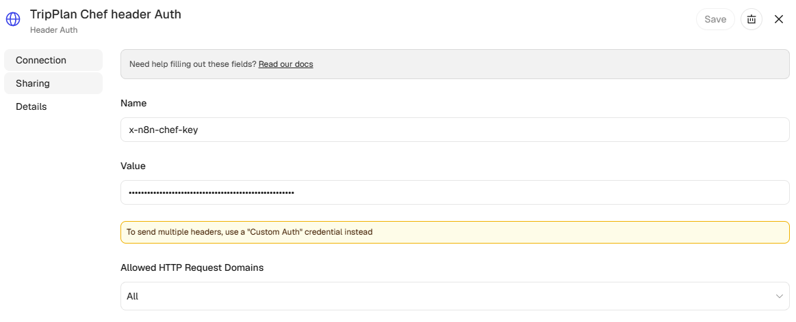

### CHEFS Form Authentication (to read submissions)

Create a **CHEFS Form Authentication** credential with the form's **Form ID** and **API key**. See [CHEFS Form Authentication](./credentials-and-nodes.md#chefs-form-authentication-chefsformauth).

## Step 2 — Build the workflow

Minimum shape:

```text
Webhook (POST, path "trip-plan", Header Auth)
  → CHEFS Submission Extractor (Submission ID = {{ $json.body.submissionId }})
  → … your logic …
```

### Webhook node

| Setting        | Value                                                                                         |
| -------------- | --------------------------------------------------------------------------------------------- |
| HTTP Method    | `POST`                                                                                        |
| Path           | A unique, readable path, for example `trip-plan`. This becomes the `<webhookPath>` in Step 3. |
| Authentication | **Header Auth** → the credential from Step 1                                                  |
| Respond        | Immediately (default)                                                                         |

The Webhook outputs the CHEFS payload under `body`:

```json
{
  "headers": { "x-n8n-chef-key": "…", "…": "…" },
  "params": {},
  "query": {},
  "body": {
    "formId": "ed5f9b10-xxxx-xxxx-xxxx-a6133236564a",
    "formVersion": "1a62dec9-xxxx-xxxx-xxxx-342a1cc138cd",
    "subscriptionEvent": "eventSubmission",
    "submissionId": "974900b1-xxxx-xxxx-xxxx-bcbb02b8b9bd"
  }
}
```

CHEFS sends only IDs. Use the **CHEFS Submission Extractor** to fetch the answers.

### CHEFS Submission Extractor

| Setting                       | Value                                                                                         |
| ----------------------------- | --------------------------------------------------------------------------------------------- |
| Credential                    | **CHEFS Form Authentication** for this form                                                   |
| Submission ID                 | `{{ $json.body.submissionId }}`                                                               |
| Field Mapping Mode            | **UI Field Pairs** or **JSON** to pick fields, or **Get Full Submission Data** for everything |
| On Draft / Deleted Submission | **Process Normally** (default), **Stop**, or **Send to Draft / Deleted Output**, see below    |

With **Get Full Submission Data**, form answers are under `submission.data` (for example `{{ $json.submission.data.email }}`) and the submission flags (`draft`, `deleted`, `confirmationId`, `createdBy`, …) are at the top level.

:::caution[Fetch the submission once, right after the event]
CHEFS sends the event only when the submitter clicks **Submit**, never when they save a draft (the CHEFS documentation says drafts trigger it too, but current CHEFS does not). So when the extractor runs straight after the Webhook, it reads the submitted data.

Later in the run that can change. If the submitter clicks **Recall Submission**, CHEFS marks the submission as a draft again, and from then on the CHEFS API returns their in-progress edits. There is no API call that returns the previously submitted version. So:

- fetch the submission once, right after the Webhook (and again right after **CHEFS Resubmit Wait**), and reuse that output in later nodes, for example `{{ $('Extract Submission').item.json }}`, or store it in a Data Table for long-running cases;
- don't fetch it from CHEFS again later in the run.

The extractor's **On Draft / Deleted Submission** option (every Field Mapping Mode) decides what happens if a fetch returns a draft, or a submission deleted in CHEFS. **Process Normally** (the default) passes it on like any other submission. **Stop (Output Nothing)** drops it, so the run stops there without an error and shows as **Succeeded**. **Send to Draft / Deleted Output** adds **Draft** and **Deleted** outputs to the node so you can handle each case, for example by notifying someone. Details: [On Draft / Deleted Submission](./credentials-and-nodes.md#on-draft--deleted-submission).
:::

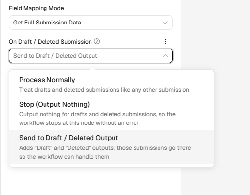

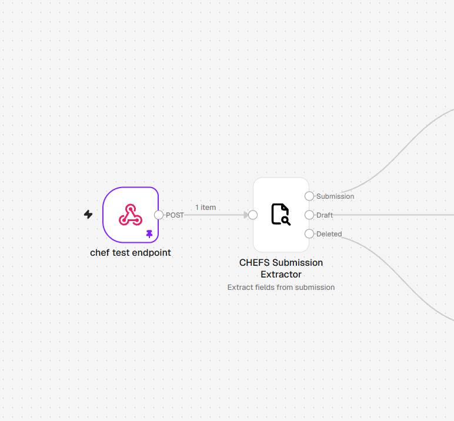

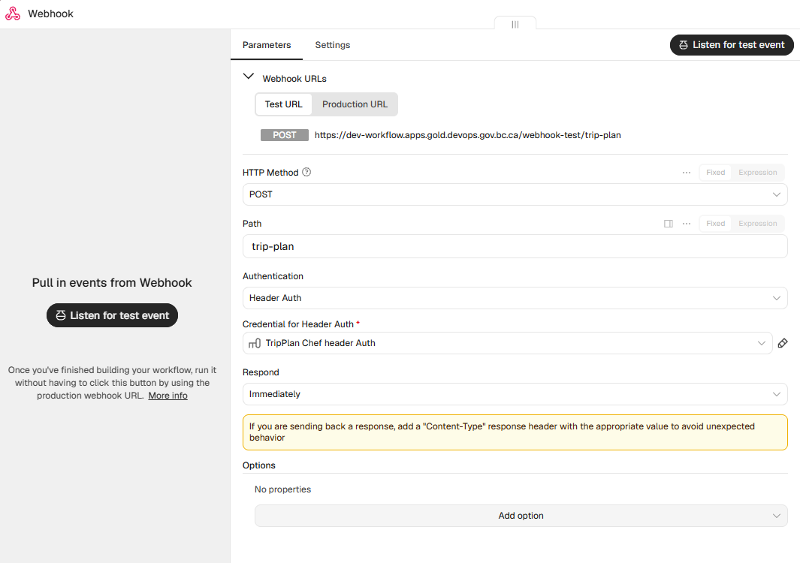

## Step 3 — Configure Event Subscription in CHEFS

1. Publish the form in CHEFS.
2. Go to **Manage Form → Form Settings → Edit**, tick **Allow event subscription**, and save.
3. Open the new **Event Subscription** panel and fill it in:

| CHEFS field    | Value                                                  |
| -------------- | ------------------------------------------------------ |
| Endpoint URL   | One of the two URLs below                              |
| Key            | The Header Auth **Name**, for example `x-n8n-chef-key` |
| Endpoint Token | The Header Auth **Value**                              |

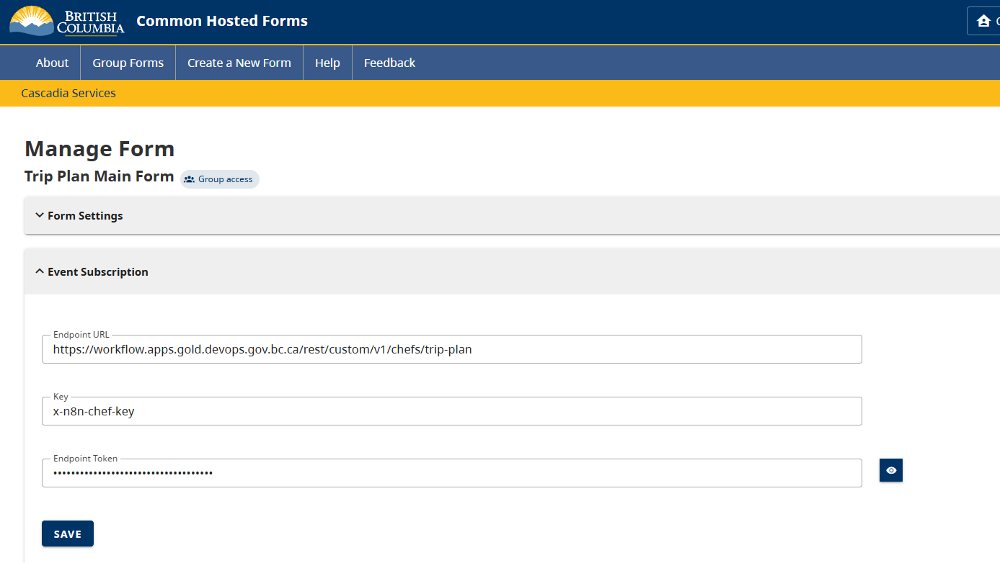

### Which Endpoint URL?

| Endpoint URL                                                                          | Use it when                                                                                                                                                                     |
| ------------------------------------------------------------------------------------- | ------------------------------------------------------------------------------------------------------------------------------------------------------------------------------- |
| `https://workflow.digital.gov.bc.ca/rest/custom/v1/chefs/<webhookPath>` (recommended) | Always works. **Required** if the workflow uses **CHEFS Resubmit Wait** to wait for a resubmission.                                                                             |
| `https://workflow.digital.gov.bc.ca/webhook/<webhookPath>` (direct n8n webhook)       | The workflow does not use CHEFS Resubmit Wait. Every submission **and every resubmission** starts the workflow from the beginning, so the workflow must tell them apart itself. |

- **Platform endpoint** (`/rest/custom/v1/chefs/…`): receives every CHEFS event. A fresh submission is forwarded to your Webhook node at `/webhook/<webhookPath>`. A resubmission that a **CHEFS Resubmit Wait** registered for is sent to that waiting execution instead. Form publish/unpublish events are dropped before they reach n8n. Your Header Auth key is passed through and checked by the Webhook node as usual.
- **Direct n8n webhook** (`/webhook/…`): CHEFS calls your Webhook node directly, and its Header Auth checks the key. Every event starts a **new** execution from the Webhook node, and a CHEFS Resubmit Wait is never resumed. That means:
  - **Resubmissions start the workflow again from the beginning**, with the same `submissionId` as the original submission. If the workflow must treat them differently (for example, skip creating a new record and update the existing one), it has to detect them itself. A simple way: store each `submissionId` in an n8n **Data Table** when it first arrives, and at the start of the workflow look it up; if it is already there, it is a resubmission. The **Common Hosted Form Service (CHEFS)** node's **Get Submission Statuses** can also help: a submission that has been through **REVISING** has been resubmitted.
  - **Form publish and unpublish events arrive too**, and start executions with no `submissionId`. Add an **If** node on `{{ $json.body.subscriptionEvent }}` equal to `eventSubmission` before the extractor.

Both deliver the same payload, so the Webhook node and the rest of the workflow are the same. You can switch between them by changing only the Endpoint URL in CHEFS, for example when you add a CHEFS Resubmit Wait step.

The URLs above use the production host. For other environments, keep the path and change the host:

| Environment | Platform endpoint example                                                        |
| ----------- | -------------------------------------------------------------------------------- |
| Production  | `https://workflow.digital.gov.bc.ca/rest/custom/v1/chefs/trip-plan`              |
| Dev         | `https://dev-workflow.apps.gold.devops.gov.bc.ca/rest/custom/v1/chefs/trip-plan` |

## Step 4 — Activate and test

1. **Activate** (publish) the workflow. Both Endpoint URLs reach the production webhook `/webhook/<path>`, so a workflow that is only open in the editor is not called. To debug in the editor, open the Webhook node, click **Listen for test event**, and temporarily set the CHEFS Endpoint URL to the n8n **test** webhook URL.
2. Submit the CHEFS form.
3. Check **Executions** in n8n. You should see one run that started at the Webhook node.

## Resubmissions with CHEFS Resubmit Wait

Use this when the workflow needs the submitter to **correct the same submission** — for example after a reviewer asks for changes — and then continue the same case.

### The flow

1. The workflow decides that changes are needed (for example, a reviewer chose **Request Changes** in a WIL action).
2. It emails the submitter a link to their submission, such as `https://submit.digital.gov.bc.ca/app/user/view?s=<submissionId>`.
3. It reaches a **CHEFS Resubmit Wait** node. Before pausing, the node registers `(formId, submissionId) → this execution's resume URL` with the platform.
4. The submitter opens the link and clicks **Recall Submission**. CHEFS moves the submission to **Revising**. They edit it and click **Submit**.
5. CHEFS sends `eventSubmission` for the **same** `submissionId` to `/rest/custom/v1/chefs/<path>`.
6. The platform finds the registration and calls the resume URL. The execution continues after the **CHEFS Resubmit Wait** node. No new execution is started.
7. The workflow re-reads the submission with the **CHEFS Submission Extractor** and carries on (for example, back to the reviewer).

:::note[Enable Recall on the CHEFS form]
The **Recall Submission** button only appears if the form owner turned on recall in the CHEFS form settings, and only for the submitter's own submission. A submission that is **Assigned**, **Completed** or **Deleted** in CHEFS cannot be recalled. See [CHEFS Recall Submission](https://developer.gov.bc.ca/docs/default/component/chefs-techdocs/Capabilities/Functionalities/Recall-Submission/).
:::

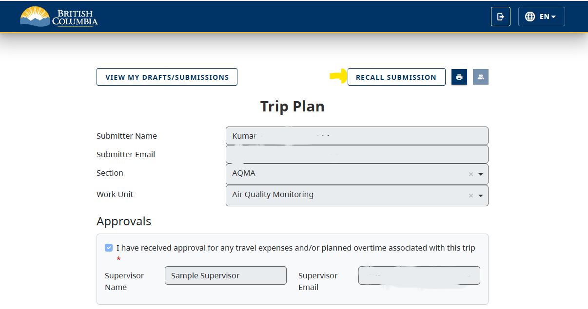

### CHEFS Resubmit Wait settings

| Setting         | Value                                                                                           |
| --------------- | ----------------------------------------------------------------------------------------------- |
| Form ID         | The CHEFS form ID, for example `{{ $('CHEFS Event').first().json.body.formId }}`                |
| Submission ID   | The submission to wait for, for example `{{ $('CHEFS Event').first().json.body.submissionId }}` |
| Authentication  | **Header Auth** → the **same** credential as the Webhook node                                   |
| Limit Wait Time | Optional. Resume automatically after a deadline if the submitter never resubmits                |

Resume is fixed to **On Webhook Call** (`POST`, response `200`); those settings are hidden.

When it resumes, the node outputs the CHEFS payload under `body`, just like the Webhook node, so the next node can use `{{ $json.body.submissionId }}`.

:::caution[Things to know]

- The node fails before pausing if it cannot register with the platform (for example `N8N_BASE_URL` or `INTERNAL_AUTH_TOKEN` is not set in the n8n runtime). See [Troubleshooting](./credentials-and-nodes.md#troubleshooting).
- Only **one** waiting execution can be registered per form + submission. A second registration replaces the first.
- Saving a draft while revising does not resume the wait; only **Submit** does. The extractor after the wait therefore reads the resubmitted data.
- If you use **Limit Wait Time** and the deadline passes, the registration stays in the database. A later resubmission is then forwarded to a resume URL that no longer waits, and CHEFS gets an error back. Send a fresh submission in that case.
  :::

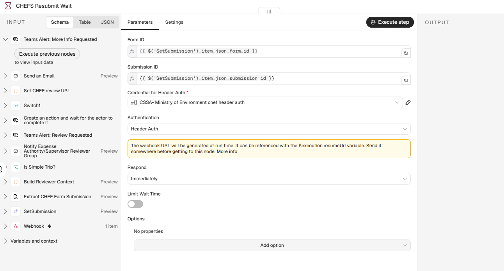

_From a real workflow: Form ID and Submission ID come from an earlier Set node. Any expression that resolves to the CHEFS IDs works._

## Sample workflow

[**Download the sample workflow JSON**](./samples/chefs-event-subscription-review-loop.json) and import it with **Workflows → Import from File**. The same graph is also available in the built-in template library as **CHEFS submission review and resubmission** (template `3001`, in the **CHEFS workflow patterns** collection); the library version omits all credential references and pinned data.

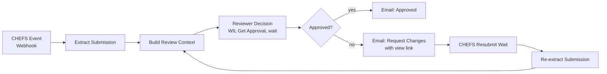

What it shows:

- a submission starts the run and its data is fetched once, straight away;
- a reviewer group gets an **Approve / Request Changes** action in the Workflow User Portal (see [pattern B](./wil-show-form.md) for using a form instead of buttons);
- **Request Changes** emails the submitter the view link and waits on **CHEFS Resubmit Wait**;
- the resubmission resumes the same run, its data is fetched again, and it goes back to the reviewer.

After importing:

1. Select your credentials on every node marked with a warning: Header Auth (Webhook and Resubmit Wait), CHEFS Form Authentication (both extractors), Workflow Interaction Layer API (Reviewer Decision), SMTP (both emails).
2. Change the Webhook **Path** if `trip-plan` is already used, and use the same value in the CHEFS Endpoint URL.
3. In **Build Review Context**, replace `submission.data.fullName` and `submission.data.email` with your form's field API names.
4. In **Reviewer Decision**, set **Actor ID** / **Actor Type** to the group, role or user who should review.
5. Activate the workflow and configure CHEFS as in [Step 3](#step-3--configure-event-subscription-in-chefs).

:::note
Node types in the sample use the `CUSTOM.` prefix, which is how the CHW n8n image loads the community nodes. If your instance loads them under a different prefix, n8n shows the nodes as unknown after import; replace the prefix in the JSON before importing.
:::

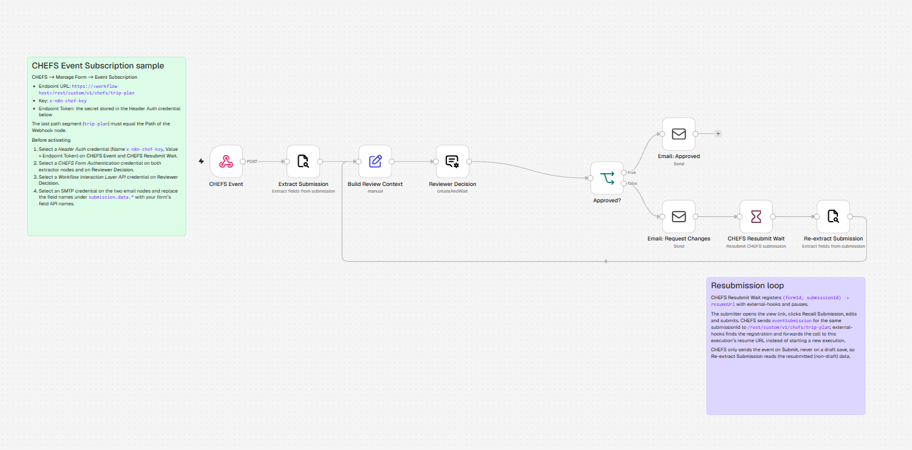

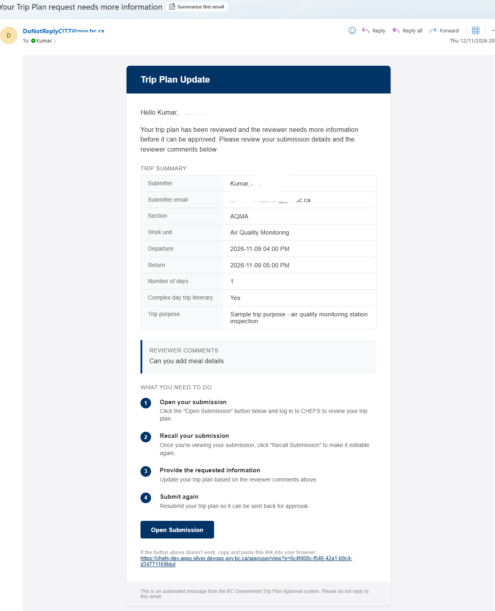

_A styled version of the sample email. The link has the form `https://<chefs-host>/app/user/view?s=<submissionId>`._
