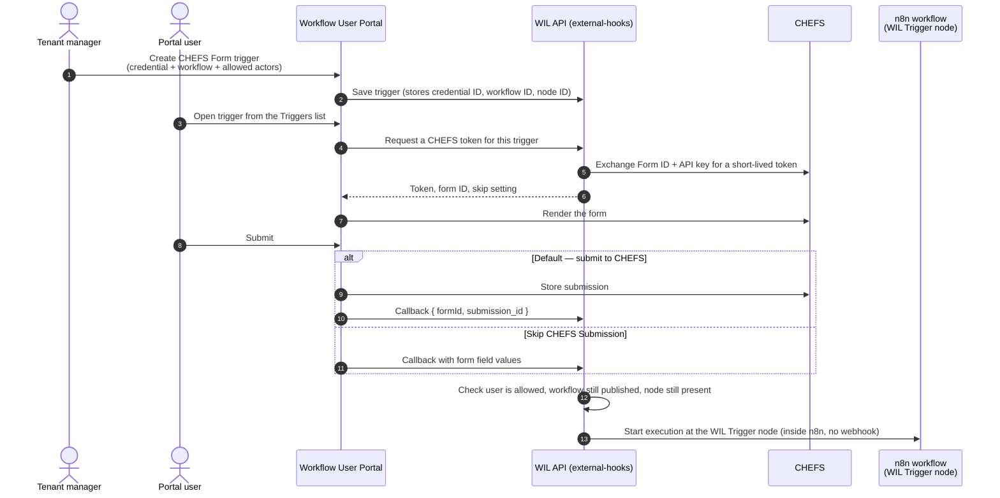
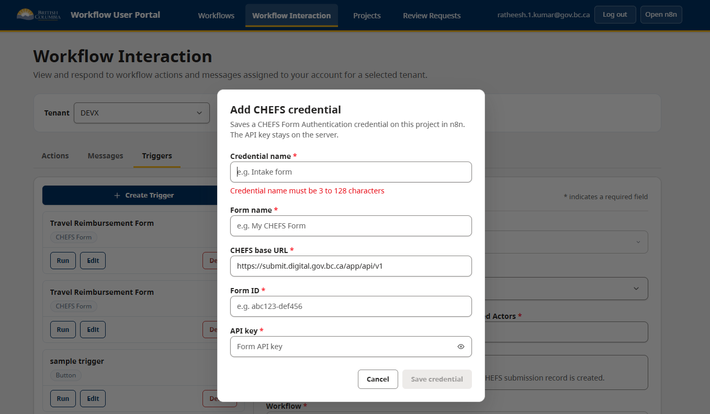
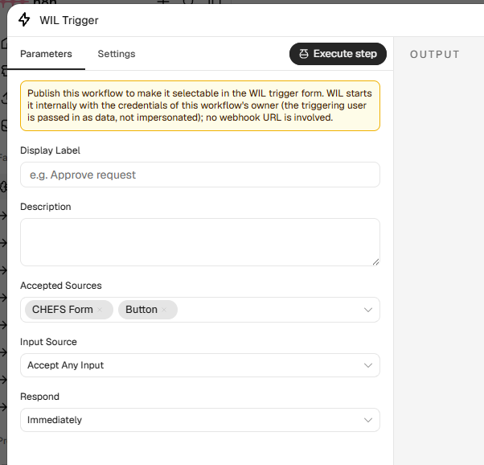
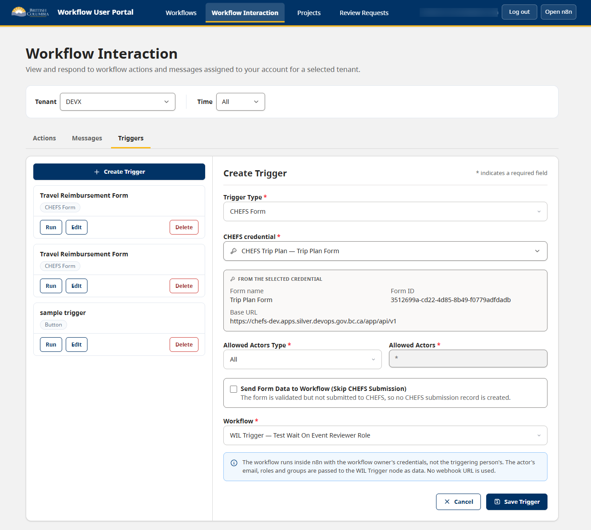
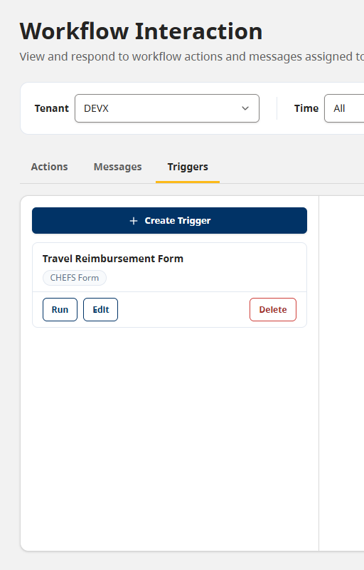
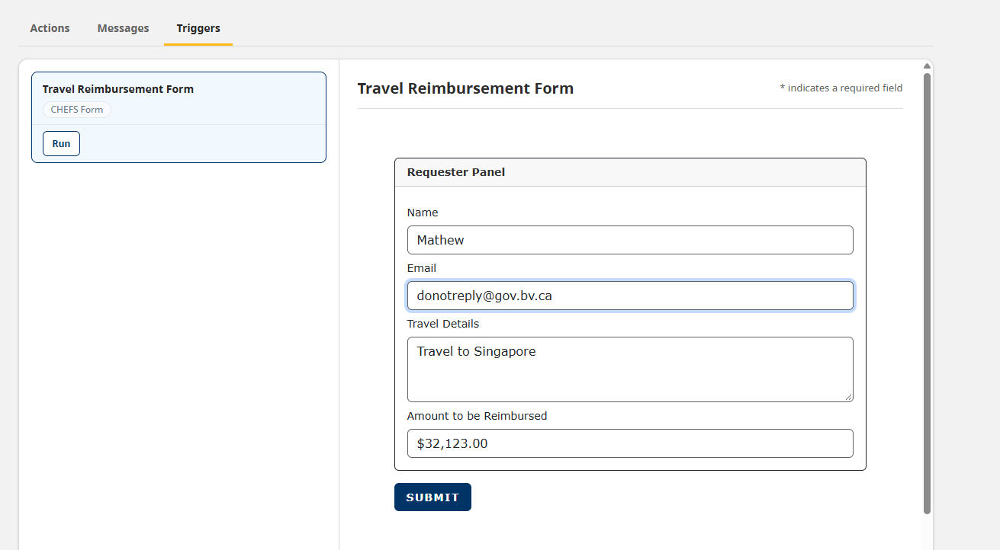
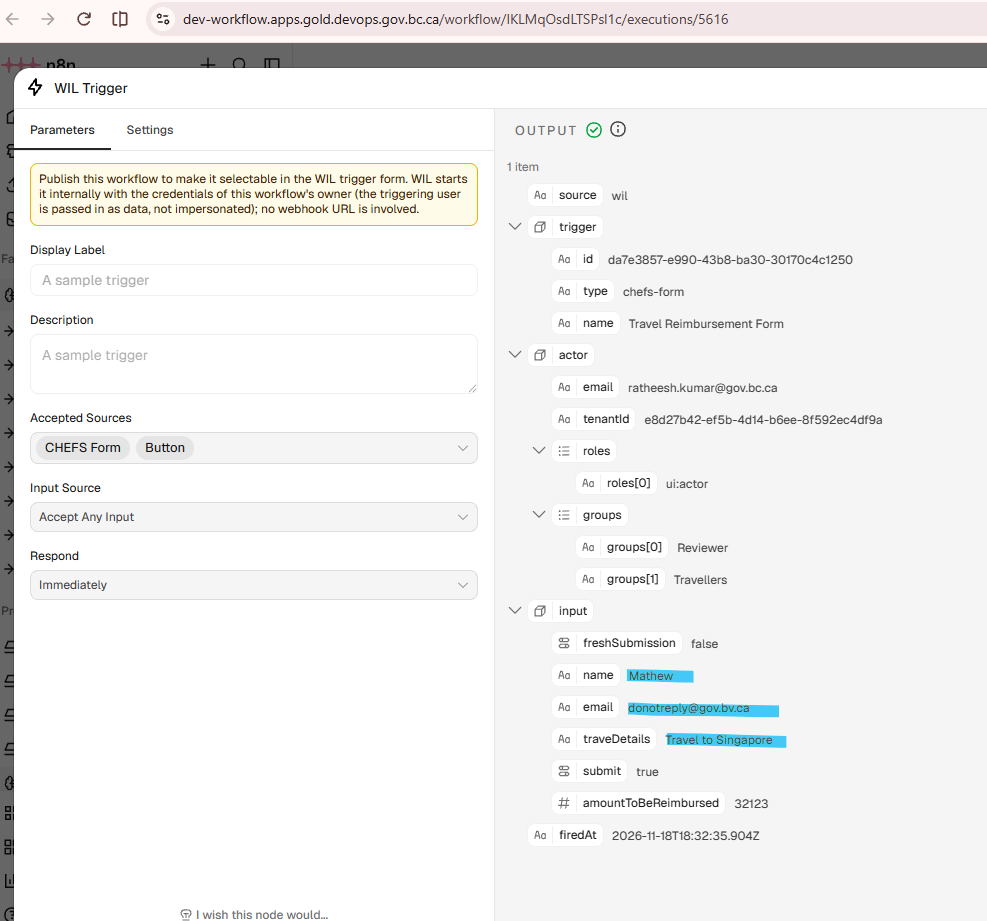

# Pattern C — Start a workflow from a CHEFS form in the Workflow User Portal

A tenant manager publishes a CHEFS form as a **trigger** in the Workflow User Portal. Allowed users open it from the portal's **Triggers** list, fill it in, and submitting it starts a workflow at its **WIL Trigger** node.

Use this pattern when signed-in staff start a case from the portal and you do not want to hand out webhook URLs or n8n access.

## How it works



The run starts **inside n8n**, as the workflow owner. There is no webhook URL to protect. The user who submitted is passed to the workflow as data (`actor`).

## Step 1 — Create a CHEFS Form Authentication credential

You can create it in either place. Both produce the same n8n credential.

**In the portal** (no n8n access needed):

1. Open **Workflow Interaction**, pick the **Tenant**, then **Triggers** → **Create Trigger** → Trigger Type **CHEFS Form**.
2. In **CHEFS credential**, choose to add a new credential. The **Add CHEFS credential** dialog opens:



3. Fill in the fields and click **Save credential**:

| Field           | Value                                                                       |
| --------------- | --------------------------------------------------------------------------- |
| Credential name | A name people will recognise, for example `Trip Plan – Prod`                |
| Form name       | The form's display name                                                     |
| CHEFS base URL  | For example `https://submit.digital.gov.bc.ca/app/api/v1`                   |
| Form ID         | The CHEFS form ID                                                           |
| API key         | The form's CHEFS API key. When editing, leave blank to keep the stored key. |

The credential is created in the tenant's n8n project. You need permission to create credentials in that project; otherwise the create option is not offered.

**In n8n**: create a **CHEFS Form Authentication** credential in a project linked to the tenant. It then appears in the portal's credential picker for anyone who can read it. See [CHEFS Form Authentication](./credentials-and-nodes.md#chefs-form-authentication-chefsformauth); use **Test** to check it.

## Step 2 — Add a WIL Trigger node

In n8n, start the workflow with a **WIL Trigger** node:

| Parameter        | Value                                                                                                                           |
| ---------------- | ------------------------------------------------------------------------------------------------------------------------------- |
| Display Label    | Name shown in the portal's workflow dropdown, for example `Start trip plan`                                                     |
| Description      | Optional help text next to the workflow                                                                                         |
| Accepted Sources | Must include **CHEFS Form**                                                                                                     |
| Input Source     | **Accept Any Input** (declared fields are used by Button triggers)                                                              |
| Respond          | **Immediately** (recommended). **Last Node** waits up to the Response Timeout and returns the last node's output to the portal. |

Then **publish** the workflow. Only published workflows owned by the tenant's projects appear in the portal.



## Step 3 — Create the trigger in the portal

Tenant managers do this under **Workflow Interaction → Triggers → Create Trigger**:

| Field                                              | Value                                                                                                                                            |
| -------------------------------------------------- | ------------------------------------------------------------------------------------------------------------------------------------------------ |
| Trigger Type                                       | **CHEFS Form** (cannot be changed later)                                                                                                         |
| CHEFS credential                                   | The credential from Step 1. Its form name, form ID and base URL are shown for checking.                                                          |
| Workflow                                           | The published workflow and WIL Trigger node from Step 2                                                                                          |
| Allowed Actors Type                                | **All**, **Role**, **Group** or **User**                                                                                                         |
| Allowed Actors                                     | The role names, group names or user emails allowed to use the trigger (not needed for **All**)                                                   |
| Send Form Data to Workflow (Skip CHEFS Submission) | Off: the form is stored in CHEFS and the workflow receives the submission ID. On: nothing is stored in CHEFS; the workflow receives the answers. |



Click **Save Trigger**. The trigger appears in the list, where managers can **Run**, **Edit** or **Delete** it:



## Step 4 — What users see

1. Users matching **Allowed Actors** open **Workflow Interaction → Triggers** for the tenant and see the trigger with a **Run** button.
2. **Run** shows the CHEFS form.
3. **Submit** starts the workflow and shows a confirmation.



## Step 5 — Use the data in the workflow

The WIL Trigger node outputs one item per submission:

```json
{
  "source": "wil",
  "trigger": { "id": "…", "type": "chefs-form", "name": "Start trip plan" },
  "actor": { "email": "user@gov.bc.ca", "tenantId": "…", "roles": ["…"], "groups": ["…"] },
  "input": { "formId": "11111111-…", "submission_id": "974900b1-…" },
  "firedAt": "2026-11-18T19:00:00.000Z"
}
```

`input` depends on the skip setting:

| Skip CHEFS Submission | `input`                                                                                                                                                                                                                           | Next step                                                                           |
| --------------------- | --------------------------------------------------------------------------------------------------------------------------------------------------------------------------------------------------------------------------------- | ----------------------------------------------------------------------------------- |
| Off                   | `{ formId, submission_id }`                                                                                                                                                                                                       | **CHEFS Submission Extractor** with Submission ID `{{ $json.input.submission_id }}` |
| On                    | The form's field values as a flat object, keyed by field API name, for example `{ "name": "…", "email": "…", "amountToBeReimbursed": 32123 }`. Button components (`submit`) and CHEFS flags (`freshSubmission`) are included too. | Use `{{ $json.input.email }}` directly; store it if you need it later               |

Field selection (sending only some fields) is not available for triggers. Pick the fields you need in the workflow.

:::caution[`actor` is information, not proof]
The platform checks that the user is allowed to use the trigger before starting the run. The `actor` object is passed as plain data. Do not use it to grant extra permissions inside the workflow, and do not return data in **Last Node** mode that the allowed users should not see.
:::



_Skip CHEFS Submission is on here, so input holds the form values. Form components such as the submit button (submit) and CHEFS flags (freshSubmission) are included too._

## Example

```text
WIL Trigger (Accepted Sources: CHEFS Form)
  → CHEFS Submission Extractor (Submission ID = {{ $json.input.submission_id }}, JSON mapping)
  → Workflow Interaction Layer (Create, Wait and Get Data, Show Form to the "Approver" group)   ← pattern B
  → …
```

## Trigger status and changes

| Portal status | Meaning                                      | Fix                                                                |
| ------------- | -------------------------------------------- | ------------------------------------------------------------------ |
| _(no badge)_  | Live and ready                               | —                                                                  |
| Unpublished   | The workflow is no longer published          | Publish the workflow again                                         |
| Node removed  | The WIL Trigger node was deleted or disabled | Restore the node, or edit the trigger to point at another workflow |

Renaming the workflow or the node does not break the trigger: the portal stores IDs, not names. Firing an unavailable trigger returns `409 WIL_TARGET_UNAVAILABLE`.

The whole feature can be turned off by the platform team (`WIL_N8N_NODE_TRIGGERS_ENABLED=false`): the workflow dropdown is then empty and firing returns `503`. See [Trigger targets](../../external-ui/WIL/trigger-targets.md) for the full API.
