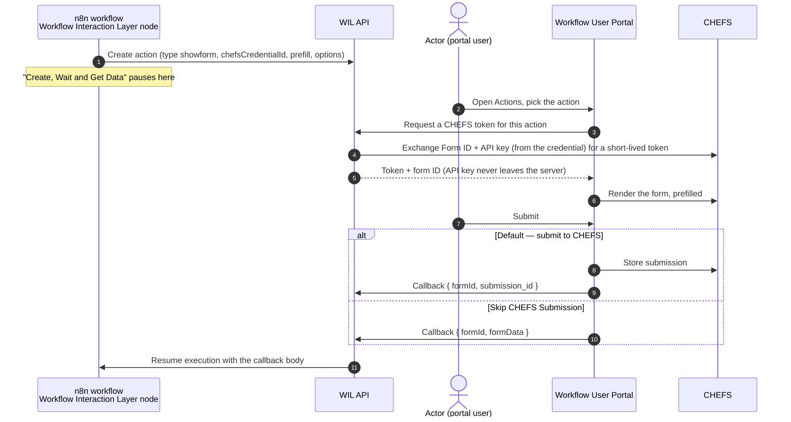
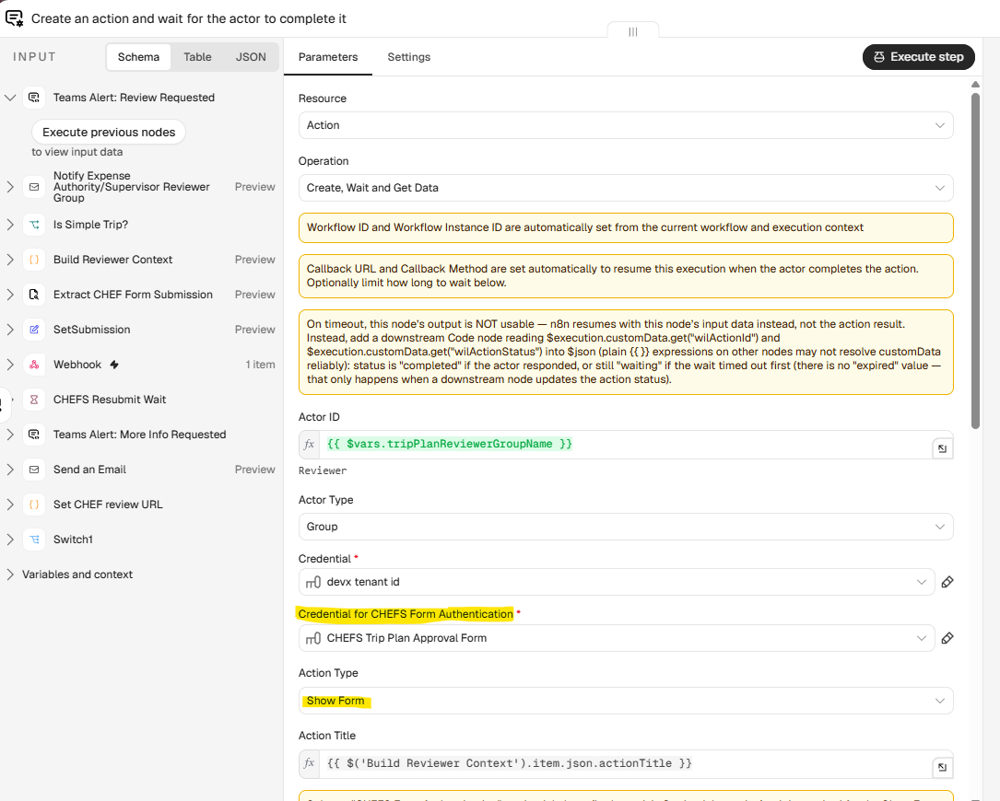
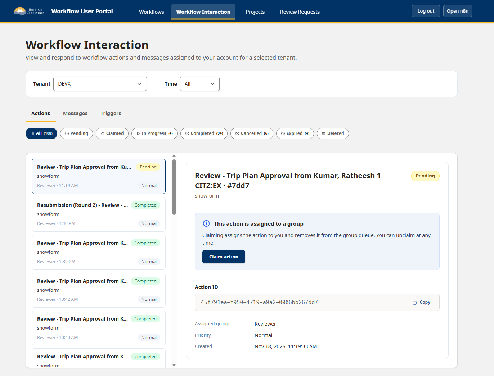
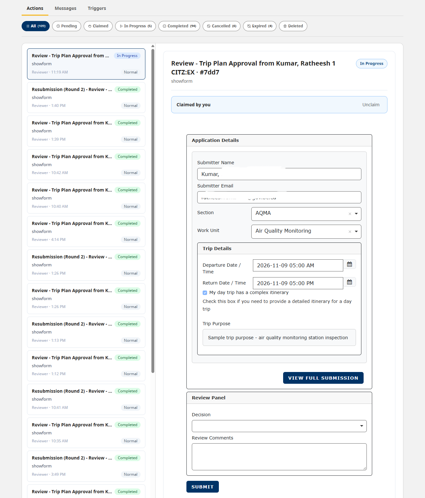
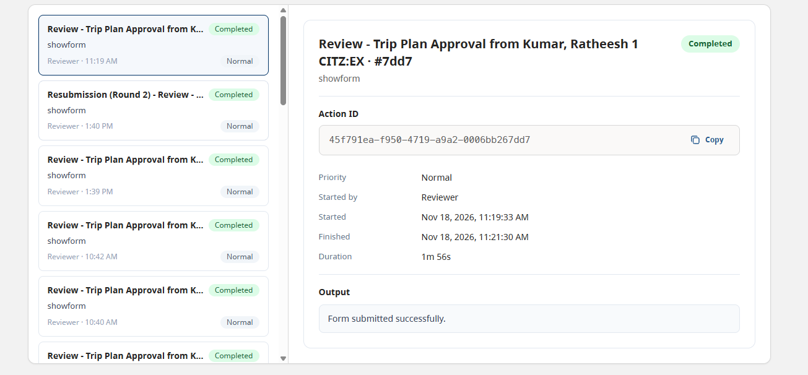

# Pattern B — Show a CHEFS form as a WIL action

A running workflow asks a person (or a group or role) to fill in a CHEFS form. The form appears in the **Workflow User Portal** under that actor's actions, rendered by the CHEFS form viewer. When they submit, the result is sent back to the workflow.

Use this pattern for human steps inside a case: assessments, reviews, decisions, data collection from staff.

## How it works



## Step 1 — Credentials

The **Workflow Interaction Layer** node needs two credentials when the action type is **Show Form**:

| Credential                         | Why                                                                                                                                                                                       |
| ---------------------------------- | ----------------------------------------------------------------------------------------------------------------------------------------------------------------------------------------- |
| **Workflow Interaction Layer API** | Creates the action in your tenant                                                                                                                                                         |
| **CHEFS Form Authentication**      | Identifies which CHEFS form to show and lets the platform get a CHEFS token for it. Select it in the node's **Credentials** section; the node shows a reminder notice when it is missing. |

Only the credential's **ID** is stored on the action. The API key stays encrypted in n8n and is used only on the server when a user opens the action.

:::caution[The credential must belong to your tenant]
When a user opens the action, the platform only accepts a CHEFS credential that is owned by, or shared with, an n8n project linked to the tenant. Otherwise the user sees an error instead of the form. Create the credential in the workflow's project, or share it with that project.
:::

## Step 2 — Configure the node

Add a **Workflow Interaction Layer** node:

| Setting      | Value                                                                                             |
| ------------ | ------------------------------------------------------------------------------------------------- |
| Resource     | **Action**                                                                                        |
| Operation    | **Create, Wait and Get Data** (recommended) or **Create**                                         |
| Actor ID     | Who should fill in the form: a user email, a group name or a role name                            |
| Actor Type   | `user`, `group`, `role` (also `system`, `other`)                                                  |
| Action Type  | **Show Form**                                                                                     |
| Action Title | What the actor sees in the action list, for example `Assess trip plan {{ $json.confirmationId }}` |

Then choose one of the ways of using the form below.



_The CHEFS Form Authentication credential field appears once Action Type is Show Form._

## Ways to use Show Form

### 1. Collect a new CHEFS submission (default)

Leave **Send Form Data to Callback (Skip CHEFS Submission)** off.

- The form is submitted to CHEFS, which stores a submission (with its confirmation ID, status history, CHEFS notifications, exports, and so on).
- The workflow receives only the reference:

  ```json
  { "formId": "11111111-1111-1111-1111-111111111111", "submission_id": "974900b1-…" }
  ```

- Add a **CHEFS Submission Extractor** after the WIL node with **Submission ID** = `{{ $json.submission_id }}` to read the answers.

Choose this when CHEFS should remain the system of record for the form data.

### 2. Send the form data straight to the workflow (Skip CHEFS Submission)

Turn on **Send Form Data to Callback (Skip CHEFS Submission)**.

- CHEFS still renders and validates the form, but **no submission is stored in CHEFS**. Draft saves are ignored.
- The workflow receives the answers directly:

  ```json
  {
    "formId": "11111111-1111-1111-1111-111111111111",
    "formData": { "firstName": "Nicholas", "lastName": "Cognito", "annualIncome": 52000 }
  }
  ```

- No extractor is needed. Because CHEFS keeps no copy, store `formData` yourself (for example in a Data Table, SharePoint or a database) if you need it later.

Choose this when the form is only a data-entry screen for the workflow, for example a reviewer's decision form.

### 3. Send only selected fields

With Skip CHEFS Submission on, set **Callback Data** to **Selected Fields Only** and list the fields:

| Output Key | Source Path    |
| ---------- | -------------- |
| `decision` | `decision`     |
| `city`     | `address.city` |

or, in JSON mode, `{ "decision": "decision", "city": "address.city" }`.

- Paths use the same dot notation as the **CHEFS Submission Extractor** (`items.0.name` for arrays).
- Selection happens **in the user's browser**: fields you do not list never leave it. Use this to keep sensitive answers out of the workflow.
- **Missing Field Behavior**: **Return Null** keeps the key with `null`; **Omit Field** drops it.
- At least one field is required.

```json
{ "formId": "11111111-1111-1111-1111-111111111111", "formData": { "decision": "approve", "city": "Victoria" } }
```

### 4. Prefill the form

Put values in **Form Pre-Fill Data**, keyed by the CHEFS field **API names**:

```json
{
  "tripName": "{{ $json.tripName }}",
  "startDate": "{{ $json.startDate }}"
}
```

The portal also fills these keys from the signed-in user's profile, if the form has fields with these API names. They **override** your values for the same keys:

| Field API name | Filled from       |
| -------------- | ----------------- |
| `idpUserId`    | IDIR user GUID    |
| `username`     | IDIR username     |
| `firstName`    | Given name        |
| `lastName`     | Family name       |
| `fullName`     | Display name      |
| `email`        | Email             |
| `idp`          | Identity provider |

A common combination with [pattern A](./event-subscription.md): the applicant submits in CHEFS, the workflow extracts their answers, then shows a reviewer an assessment form prefilled with the applicant's name and reference number.

### 5. Start from an existing submission

Set **CHEFS Form Submission ID** to load the data of an existing submission of the same form into the form. When it is set, **Form Pre-Fill Data** is ignored.

:::caution
The actor does not edit that submission in place. Submitting creates a **new** submission (or sends `formData`, if Skip CHEFS Submission is on). Editing an existing submission from the portal is not supported yet. To have a submitter correct their own submission, use [Recall and CHEFS Resubmit Wait](./event-subscription.md#resubmissions-with-chefs-resubmit-wait).
:::

## Create vs Create, Wait and Get Data

| Operation                     | Behaviour                                                                                                                                                                                          |
| ----------------------------- | -------------------------------------------------------------------------------------------------------------------------------------------------------------------------------------------------- |
| **Create, Wait and Get Data** | Creates the action and pauses. When the actor submits, the node outputs the callback body (`submission_id` or `formData`). The callback URL is set for you. Use **Limit Wait Time** for deadlines. |
| **Create**                    | Creates the action and continues immediately. You provide **Callback Method** and **Callback URL** yourself (for example another workflow's Webhook) to receive the result.                        |

**Detecting a timeout.** With **Limit Wait Time**, a timed-out node outputs its _input_ items, not a status. Read `wilActionStatus` from execution custom data in a **Code** node: it is still `waiting` after a timeout and `completed` after a real submission. Details: [Create, Wait and Get Data](../../community-nodes/workflow-interaction-layer/node-operations.md#create-wait-and-get-data).

## What the actor sees

1. The actor signs in to the Workflow User Portal, opens **Workflow Interaction** and picks the **Tenant**.
2. The new action appears under **Actions** as **Pending**, with your Action Title and priority.
3. If the action is assigned to a **group** or **role**, they click **Claim action**. That assigns it to them and removes it from the group queue; they can **Unclaim** at any time. The action moves to **In Progress**.

   

4. The CHEFS form is shown inside the action, prefilled.

   

5. After **Submit**, the action is **Completed** and its output reads "Form submitted successfully."

   

## Example: reviewer assessment step

```text
… (case data in $json)
  → Workflow Interaction Layer
       Resource: Action, Operation: Create, Wait and Get Data
       Actor ID: Reviewer, Actor Type: group
       Action Type: Show Form, Credential: CHEFS – Trip Plan Assessment
       Form Pre-Fill Data: { "tripReference": "{{ $json.confirmationId }}" }
       Send Form Data to Callback: on
       Callback Data: Selected Fields Only → decision = decision, comments = comments
  → Switch on {{ $json.formData.decision }}
```

## Limits and notes

- One action targets one actor value (one user, one group or one role). Once it is completed, it no longer waits for input.
- The CHEFS form must be published, and the credential's API key must be valid for that form.
- The CHEFS base URL in the credential must be allowed by the platform (`CHEFS_BASE_URL` / `CHEFS_ALLOWED_ORIGINS`). Ask the platform team to add other CHEFS environments.
- Callback data is what the browser sends after CHEFS validation. Validate anything that matters (amounts, IDs) again in the workflow.
