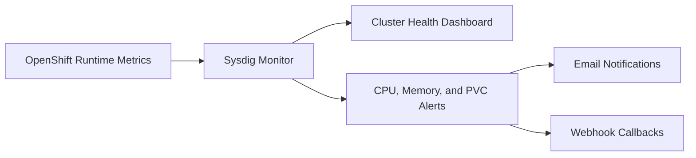

# Sysdig

Sysdig is the monitoring and alerting platform used in this repository for infrastructure-level operational visibility.

In this project, Sysdig is not used as an application deployment tool. It is used as an **operations observability service** to surface cluster health signals and notify operators when resource conditions cross defined thresholds.

## Monitoring Flow



## Why This Project Uses Sysdig

This platform runs on OpenShift and hosts multi-environment workflow workloads. That makes continuous visibility into runtime health a platform concern, not just an application concern.

The repository uses Sysdig to provide:

- a shared dashboard for environment-level cluster health
- alerting on sustained high CPU utilization
- alerting on sustained high memory utilization
- alerting on sustained high persistent volume usage
- email notifications to the configured operational recipients
- webhook callbacks to a configured endpoint, when provided

At an architectural level, Sysdig fills the gap between deployment automation and runtime operations:

- GitHub Actions and Helm deliver the platform
- Sysdig monitors whether the running platform is healthy after delivery

## What This Repository Provisions In Sysdig

The Terraform configuration under `terraform/sysdig` currently provisions Sysdig Monitor resources for the `b0c13b` and `c89a45` footprints.

Each workspace instantiates the shared module and passes its own slug, which is used to name and scope the provisioned resources.

The module creates, per workspace:

- a dashboard named `<workspace> Cluster Health`
- an email notification channel
- a webhook notification channel, created only when a webhook URL is configured
- one CPU, one memory, and one persistent volume claim (PVC) alert for each environment namespace (`<workspace>-dev`, `<workspace>-test`, `<workspace>-prod`)
- a separate CPU, memory, and PVC alert for **each** of `n8n` and `pgo` in **each** environment namespace

The dashboard includes panels for:

- total CPU usage in cores
- total memory usage, measured in bytes and scaled for display
- outbound network throughput in bytes per second, calculated over five minutes

The panels are filtered to the workspace's environment namespaces and grouped by namespace and cluster.

An alert fires when its condition is true for **five consecutive minutes**. Alerts notify the configured email recipients and, when a webhook URL is configured, send a callback to that endpoint.

To turn those callbacks into Teams Adaptive Cards, see [Sysdig Alert Notifications](../operations/sysdig-alert-notifications.md) for the n8n workflow and Code node script.

### Alert scopes

Alerts are generated from two kinds of scope, driven by module variables:

| Scope       | Example alert suffix | Namespace filter            | Workload or PVC name filter        |
| ----------- | -------------------- | --------------------------- | ---------------------------------- |
| Environment | `c89a45-dev`         | `<workspace>-<environment>` | All workloads or claims            |
| Component   | `c89a45-dev (n8n)`   | `<workspace>-<environment>` | `chwf-n8n(-.*)?`, `chwf-pgo(-.*)?` |

By default, each workspace has nine scopes (three namespace-wide and six component-specific), for **27 alerts**: nine CPU, nine memory, and nine PVC. The `alert_ids`, `memory_alert_ids`, and `volume_alert_ids` outputs are maps keyed by `dev`, `test`, `prod`, or `<environment>/<component>` (for example, `prod/n8n`).

The scopes overlap, so a breach can trigger both a component alert and its namespace-wide alert. `alert_environments` controls all three alert types and the dashboard's namespace filter.

#### CPU and memory

Environment alerts group by cluster and namespace. Component alerts also group by workload, so, for example, `chwf-n8n-main` and `chwf-n8n-worker` can produce separate alert occurrences within `c89a45-dev (n8n)`. Each group uses the **maximum** container value, so idle replicas and sidecars do not dilute a hot container's usage. The five-minute duration applies to the group even if the container with the highest usage changes. Gold and GoldDR are evaluated separately.

The default CPU and memory thresholds are both 85%. CPU uses the percentage of container CPU quota; memory uses the percentage of the container's positive memory limit. If Sysdig does not report usable limit metrics for a container, as expected for request-only PGO containers, usage is compared to a fallback budget instead:

| Fallback budget             | Default    | Usage that must be exceeded at 85% |
| --------------------------- | ---------- | ---------------------------------- |
| `cpu_alert_fallback_cores`  | 1 CPU core | 850 millicores                     |
| `memory_alert_fallback_mib` | 1024 MiB   | 870.4 MiB                          |

These are monitoring budgets, not Kubernetes limits or requests. Adjust them in the root module if observed usage calls for a different threshold.

The `alert_workloads` regexes follow the Helm names in `helm/main`; override them if those names change, or set `alert_workloads = {}` to disable component CPU and memory alerts.

#### Persistent volume usage

**High PVC Utilization** fires when one claim stays above **85%** of its filesystem capacity for **five consecutive minutes**. It calculates `100 * used / capacity` from `kubelet_volume_stats_used_bytes` and `kubelet_volume_stats_capacity_bytes`. The query pairs readings from the same reporter, then takes the highest percentage per **cluster, namespace, and claim** to avoid double-counting a shared volume. A claim without a matching positive capacity or cluster label is not evaluated.

The n8n and PGO rules match `persistentvolumeclaim`, not workload labels. The n8n filter covers the shared `chwf-n8n` claim; the PGO filter covers the operator's `chwf-pgo-*` claims, including data and local pgBackRest repository volumes where present. Other claims, such as `chwf-pgdump-backup`, are covered by the namespace-wide rule only. Override `alert_volume_claims` if these names change, set it to `{}` to disable component PVC rules, or adjust `volume_alert_threshold` in the module call.

To graph usage in Sysdig Query Explorer, use the alert expression without its final threshold comparison. For example, this returns utilization percentages for all reporting claims in `c89a45-dev`; replace that namespace in all four selectors to check another environment:

```promql
max by (kube_cluster_name, namespace, persistentvolumeclaim) (
  100 * kubelet_volume_stats_used_bytes{namespace="c89a45-dev",persistentvolumeclaim!="",kube_cluster_name!=""}
  / (kubelet_volume_stats_capacity_bytes{namespace="c89a45-dev",persistentvolumeclaim!="",kube_cluster_name!=""} > 0)
  or label_replace(
    100 * kubelet_volume_stats_used_bytes{namespace="c89a45-dev",persistentvolumeclaim!="",kube_cluster_name="",cluster!=""}
    / (kubelet_volume_stats_capacity_bytes{namespace="c89a45-dev",persistentvolumeclaim!="",kube_cluster_name="",cluster!=""} > 0),
    "kube_cluster_name", "$1", "cluster", "(.+)"
  )
)
```

Use `kubelet_volume_stats_available_bytes` to inspect remaining space in bytes; it does not have a separate alert.

## How It Is Provisioned

Provisioning is managed with Terraform, not manually through the Sysdig UI.

The entry points are:

- `terraform/sysdig/b0c13b/main.tf`
- `terraform/sysdig/c89a45/main.tf`

Each environment uses the shared Terraform module in:

- `terraform/sysdig/_module`

The module is responsible for defining the reusable Sysdig resources, while the environment layer provides values such as alert recipients and thresholds.

## Terraform Design

The current Terraform design has two layers:

| Layer                      | Purpose                                                                                  |
| -------------------------- | ---------------------------------------------------------------------------------------- |
| `terraform/sysdig/_module` | reusable Sysdig dashboard, notification channel, and alert definitions                   |
| `terraform/sysdig/b0c13b`  | environment-specific instantiation, provider config, backend config, and variable wiring |
| `terraform/sysdig/c89a45`  | environment-specific instantiation, provider config, backend config, and variable wiring |

This separation keeps the Sysdig resource model reusable while still allowing per-environment customization.

## State And Credentials

The Sysdig Terraform state is stored using the Kubernetes backend, one state per workspace:

- `b0c13b`: namespace `b0c13b-tools`
- `c89a45`: namespace `c89a45-tools`
- secret suffix: `sysdig-state`

The Sysdig provider authenticates with:

- `TF_VAR_sysdig_monitor_api_token`

`ALERT_EMAIL_RECIPIENTS` is passed to `TF_VAR_alert_email_recipients`. Set the secret in each GitHub environment to an HCL list literal, not a comma-separated string:

```text
["alice@example.com", "bob@example.com"]
```

An optional webhook callback URL is passed through:

- `TF_VAR_alert_webhook_url`

When unset (or empty), the webhook notification channel is not created and alerts notify through email only.

The webhook Authorization header is passed through:

- `TF_VAR_alert_webhook_authorization`

It is mandatory whenever a webhook URL is configured; provisioning fails with a validation error otherwise.

The GitHub Actions workflows map these Terraform variables from secrets in each workspace's GitHub environment (`sysdig` for `b0c13b`, `standard-sysdig` for `c89a45`):

| Terraform variable            | GitHub secret                 |
| ----------------------------- | ----------------------------- |
| `sysdig_monitor_api_token`    | `SYSDIG_MONITOR_API_TOKEN`    |
| `alert_email_recipients`      | `ALERT_EMAIL_RECIPIENTS`      |
| `alert_webhook_url`           | `ALERT_WEBHOOK_URL`           |
| `alert_webhook_authorization` | `ALERT_WEBHOOK_AUTHORIZATION` |

The OpenShift login used to reach the Kubernetes state backend reads `OPENSHIFT_SERVER` and `OPENSHIFT_TOKEN` from the same environment.

This keeps secrets out of the repository and aligns provisioning with the GitHub Actions environment model.

## Delivery Automation

Sysdig provisioning is automated through GitHub Actions workflows, one per workspace:

| Workspace | Workflow                                          | GitHub environment |
| --------- | ------------------------------------------------- | ------------------ |
| `b0c13b`  | `.github/workflows/sysdig-terraform.yml`          | `sysdig`           |
| `c89a45`  | `.github/workflows/sysdig-terraform-standard.yml` | `standard-sysdig`  |

Each workflow's behavior is:

- on pull requests touching that workspace or the shared module (`terraform/sysdig/_module/**`): run `terraform plan`
- on pushes to `main` touching the same paths: run `terraform apply`
- on manual dispatch: allow either `plan` or `apply`

The plan workflows also post the Terraform plan back to the pull request, which makes Sysdig monitoring changes reviewable before they are applied.

### Verify before applying

1. In Sysdig's PromQL Query Explorer, check that container metrics have the expected cluster, namespace, workload, and container labels. For example, run the following for `c89a45`, then repeat for `b0c13b`:

   ```promql
   count by (kube_cluster_name, kube_namespace_name, kube_workload_name) (
     sysdig_container_cpu_cores_used{
       kube_namespace_name=~"c89a45-(dev|test|prod)",
       kube_workload_name=~"chwf-(n8n|pgo)(-.*)?",
       container_id!=""
     }
   )
   ```

   Look for distinct cluster names wherever the workloads are running. In each workspace, run representative CPU and memory alert queries without the final `> 85` comparison to check the n8n limit metrics and the PGO fallback. An alert query with the comparison in place returns no series when usage is below threshold **or** when metrics are missing.

2. Check PVC metric labels and claim names in both workspaces. For example:

   ```promql
   count by (kube_cluster_name, cluster, namespace, persistentvolumeclaim) (
     kubelet_volume_stats_used_bytes{
       namespace=~"c89a45-(dev|test|prod)",
       persistentvolumeclaim!=""
     }
   )
   ```

   Repeat for `kubelet_volume_stats_capacity_bytes`, and run the generated PVC alert query without its final comparison. Confirm it returns distinct Gold and GoldDR series wherever claims report stats, including `chwf-n8n` and `chwf-pgo-*`. The rule uses `cluster` when `kube_cluster_name` is absent and requires the kubelet's `namespace` and `persistentvolumeclaim` labels.

3. Review the Terraform plans from both workflows before merging. With the scoped CPU and memory alerts already deployed, expect **nine additions per workspace** and no changes to existing rules or the dashboard. If upgrading directly from the two old workspace-wide alerts, those should move to the `prod` keys and update in place, preserving their IDs, alongside 16 new CPU and memory alerts and nine new PVC alerts. The former CPU `alert_id` is now `alert_ids["prod"]`. A fresh workspace should plan 27 new alerts.

## Current Scope

The current repository implementation is intentionally small and focused.

It provisions:

- baseline resource health monitoring per environment namespace and per component workload family
- baseline email-based alerting
- optional webhook callback notifications

It does not currently provision, in this repository at least:

- complex service maps
- incident routing integrations beyond email and webhook callbacks
- large policy libraries
- broad multi-environment Sysdig stacks beyond the current Terraform entry point

Team and membership management is also outside the Terraform scope. Sysdig teams, their namespace
scoping, and user access are managed separately through the `SysdigTeam` custom resource — see
[Sysdig Team Management](../operations/sysdig-team-management.md).

## Key Source Files

- `terraform/sysdig/b0c13b/main.tf`
- `terraform/sysdig/b0c13b/config.tf`
- `terraform/sysdig/c89a45/main.tf`
- `terraform/sysdig/c89a45/config.tf`
- `terraform/sysdig/_module/main.tf`
- `terraform/sysdig/_module/volume-alerts.tf`
- `terraform/sysdig/_module/variables.tf`
- `terraform/sysdig/_module/outputs.tf`
- `.github/workflows/sysdig-terraform.yml`
- `.github/workflows/sysdig-terraform-standard.yml`
